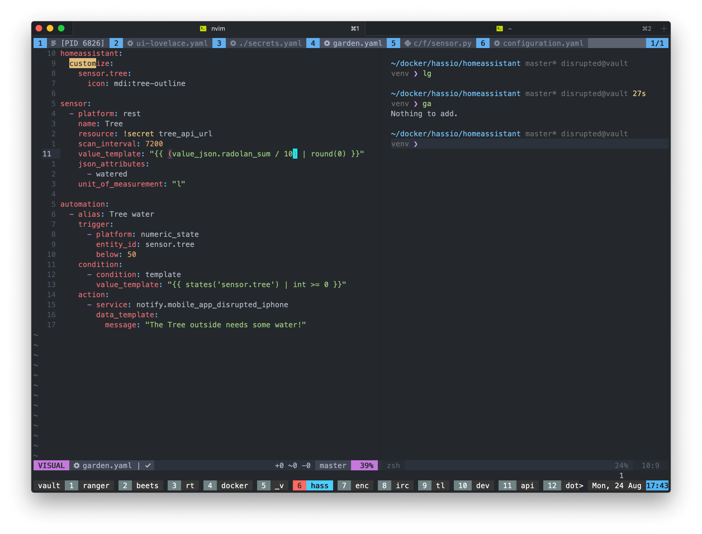

# disrupted's dotfiles

## Neovim



[`~/.config/nvim`](https://github.com/disrupted/dotfiles/tree/master/.config/nvim)

## Setup on a new machine

Dotfiles are deployed with [mise](https://mise.jdx.dev/dotfiles.html):
`~/.dotfiles` mirrors `$HOME`, `os/<os>/` holds OS-specific files.

```sh
git clone https://github.com/disrupted/dotfiles ~/.dotfiles
mkdir -p ~/.config/mise
for f in ~/.dotfiles/.config/mise/*.toml; do ln -sf "$f" ~/.config/mise/; done
# optional: select machine modules, e.g. on a work machine
echo 'env = ["work"]' > ~/.config/mise/miserc.local.toml
mise bootstrap --dry-run
mise bootstrap
```
